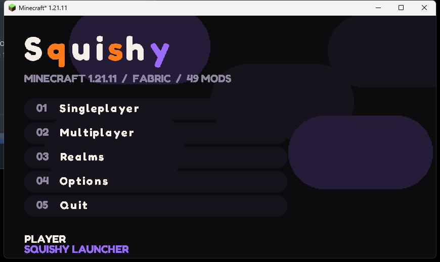

# Squishy Launcher

A Minecraft launcher with Modrinth + CurseForge mod search, kinetic-type UI, and a custom in-game home screen.



## Play (Windows)

1. Download `SquishyLauncher-win.zip` from the [Releases](../../releases) page and unzip it anywhere.
2. Run `Squishy Launcher.exe`.
3. Pick an instance on **Play** and hit the big button. First launch downloads Minecraft, Fabric, and Java if you don't have it, so give it a few minutes.

Offline username is under **Settings**. You can also sign in with Microsoft there.

## Run from source

Needs [Node.js](https://nodejs.org) 20+.

```bash
cd launcher
npm install
npm start
```

## Features

- Versions: 1.8 (vanilla), 1.21.11, 26.1, 26.2 (Fabric), plus any other release from the Library page.
- Modrinth search and one-click install with required dependencies. CurseForge search needs a free API key (Settings).
- Import mods and data from an existing Minecraft, Prism, Modrinth App, CurseForge or ATLauncher folder, or import `.mrpack` / CurseForge modpack zips.
- Fabric instances come with the Squishy home screen mod and Fabric API preinstalled.
- Picks (or downloads) the right Java for each Minecraft version.

## Repo layout

| Folder | What |
| --- | --- |
| `launcher/` | Electron app |
| `mod/` | Fabric home-screen mod for 1.21.11 (yarn mappings) |
| `mod26/` | Fabric home-screen mod for 26.x (Mojang names, Java 25) |

Build a mod with `./gradlew build` inside its folder, then copy the jar into `launcher/resources/`.

## Status

1.21.11 is tested end to end. 1.8, 26.1, 26.2, Microsoft login, modpack import and CurseForge are written but not yet tested in-game.
